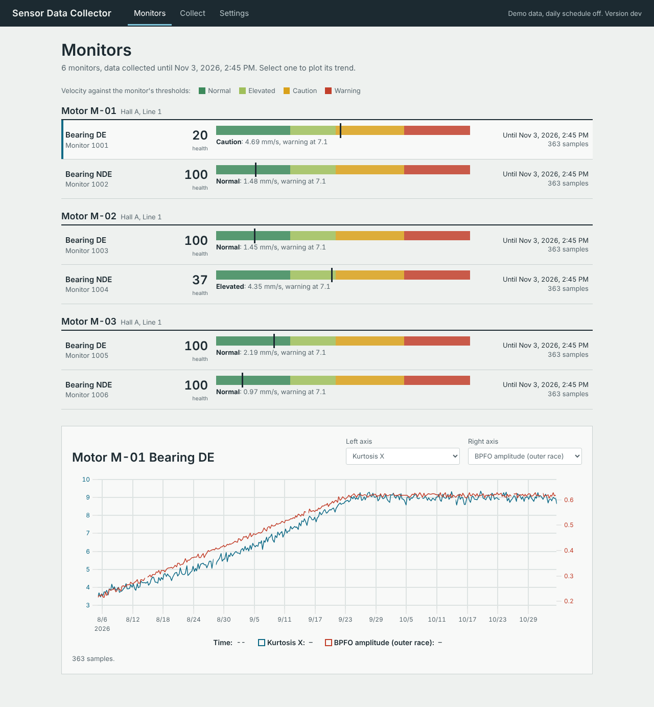
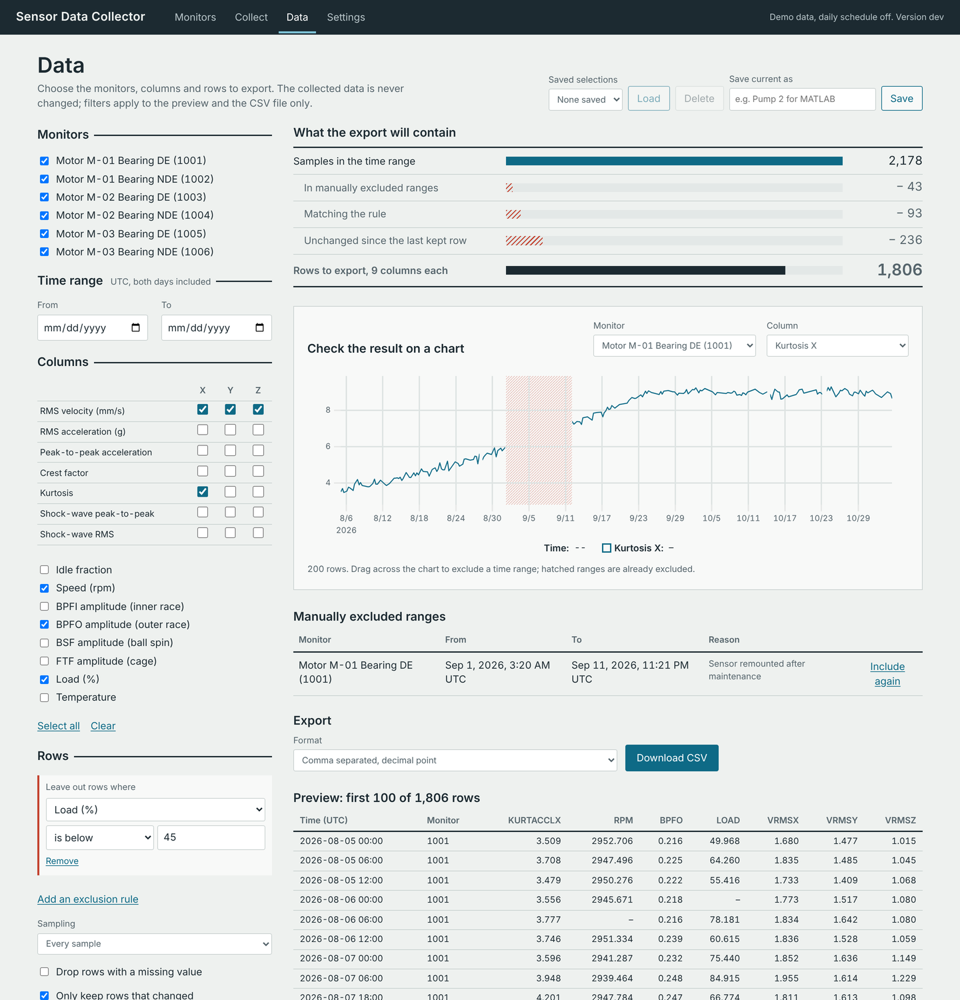
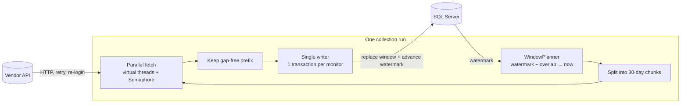

# Sensor Data Collector

[](https://github.com/EfeCaginYildirim/sensor_data_collector/actions/workflows/ci.yml)
[](https://github.com/EfeCaginYildirim/sensor_data_collector/actions/workflows/package.yml)
[](LICENSE)

A Java 21 service that collects vibration and health data from industrial motor sensors through a
vendor condition-monitoring API and stores it in SQL Server for a predictive-maintenance /
digital-twin pipeline.

I first wrote it during an engineering internship to automate a manual export. This repository is
a **ground-up rewrite** of that version: same purpose, but correct under failure, testable without
the vendor, and measurably parallel. Data can go to SQL Server or to a single embedded H2 file. The original code is preserved in the Git history.

```bash
mvn -q package -DskipTests
java -jar target/sensor-data-collector-2.0.0-SNAPSHOT.jar ui     # desktop app in the browser
java -jar target/sensor-data-collector-2.0.0-SNAPSHOT.jar demo   # same idea on the console
```

## Desktop app

`ui` starts a small local web server and opens the app in the default browser. It starts in demo
mode, so it works without credentials; switch to your vendor API in Settings.

### Download and run

The [releases](https://github.com/EfeCaginYildirim/sensor_data_collector/releases) page has a zip
per platform. It contains its own trimmed Java runtime, so nothing else needs to be installed
(about 30 MB to download, 45 MB unpacked).

- **Windows**: unzip, open the `SensorDataCollector` folder and double-click
  `SensorDataCollector.exe`. The app is not code-signed, so the first start shows *Windows
  protected your PC*: click **More info**, then **Run anyway**.
- **macOS** (Apple Silicon): unzip and move `SensorDataCollector.app` to Applications. The first
  time, macOS refuses to open it because the developer is not verified: open **System Settings >
  Privacy & Security**, scroll down and click **Open Anyway**. If macOS says the app is
  *damaged*, it was quarantined on download; run
  `xattr -dr com.apple.quarantine /Applications/SensorDataCollector.app` once.

The app has no window of its own: it lives in the browser tab it opens, and it has no Dock or
taskbar icon. Double-clicking it again while it runs opens the same session. To stop it, use
**Settings > Quit app**. Logs are in the `logs` folder of the data folder shown in Settings.

The packages are built and tested on GitHub's Windows and macOS runners: each one is started
without arguments, like a double-click, then a demo collection runs and a dataset is queried over
HTTP (`packaging/smoke-test.sh`). To build one yourself on the target OS, with a JDK 21:
`mvn package -DskipTests && packaging/package.sh target/sensor-data-collector-*.jar 2.0.0 dist`.



- **Monitors** — every sensor with its health score and a strip showing RMS velocity against the
  vendor's own thresholds (normal, elevated, caution, warning), plus a trend chart of any two
  features. The demo fleet includes two motors with a developing bearing defect.
- **Collect** — run a collection, watch it fetch time range by time range, read the run history.
- **Data** — choose what goes into a CSV file without touching the collected data (see below).
- **Settings** — demo or vendor API, credentials (the password is saved in your user folder and
  never sent back to the browser), and an optional daily schedule.
- **Language** — English or French, chosen in the top bar and remembered with the settings
  (English on first launch). Numbers, dates and chart axes follow the chosen language rather than
  the computer's or the browser's: `2,80` and `8 nov. 2026, 13:30` in French. Console and log
  output always use a decimal point, whatever the system locale.

### Data tab



Pick monitors, a date range and columns (vibration features as a family-by-axis grid, so "all
three axes of RMS velocity" is one click), then thin out the rows:

- **Exclusion rules** such as *leave out rows where idle fraction is above 0.5*; a rule may use a
  column that is not exported.
- **Sampling**: every sample, or hourly or daily means.
- **Only keep rows that changed**: a deadband on every selected column, in percent or absolute
  units. Long flat stretches collapse to a few rows; each monitor's first and last rows stay.
- **Manual exclusions**: drag across the chart to leave out a time range, for example while a
  sensor was being serviced. Each one needs a reason, is listed with it, and can be included again.

The count at the top shows what every step removes, and the chart runs the same pipeline as the
export, so it shows exactly the rows the file will contain. Selections can be saved under a name.
Files are written as UTF-8 CSV, comma-separated with a decimal point or semicolon-separated with a
decimal comma for Excel in Turkish, French or German. Nothing is deleted from the database:
filters apply at export time, and manual exclusions are stored separately with their reasons.

It is deliberately light: no framework, no build step for the front end, one 50 KB chart library
(uPlot). Data and settings live in the platform's app-data folder (`%APPDATA%\SensorDataCollector`
on Windows, `~/Library/Application Support/SensorDataCollector` on macOS), in one embedded H2
file per mode.

The server only listens on `127.0.0.1`. The link the app opens carries a random 256-bit token,
which is exchanged for an `HttpOnly`, `SameSite=Strict` cookie; requests with a foreign `Host`
header (DNS rebinding), cross-origin or non-JSON writes are refused, and a strict
Content-Security-Policy allows only the app's own scripts. Starting the app twice opens the
running instance instead of a second server.

`demo` needs no credentials or database: it starts a built-in fake of the vendor API with six
synthetic motors (two of them developing a bearing defect), backfills 60 days, runs again "one day
later", and prints what it collected.

```
== Run 1: initial backfill of 60 days ==
Run b7e2081a SUCCESS in 0.5 s
  monitor 1001   COLLECTED  basic=61    computed=244    new=305    until=2026-11-02T23:06:23Z
  ...
== Run 2: one day later - only watermark minus 3 days overlap is fetched ==
  monitor 1001   COLLECTED  basic=4     computed=16     new=5      until=2026-11-03T23:06:23Z
  ...
HTTP requests: 38 for the backfill, 13 for the incremental run

Fleet health (first week -> last week of collected data)
  id     monitor                  health  kurtosis X             BPFO amplitude
  1001   Motor M-01 Bearing DE    20      6.60 -> 8.99  RISING   0.48 -> 0.62  RISING
  1002   Motor M-01 Bearing NDE   100     2.96 -> 3.06           0.02 -> 0.02
  1003   Motor M-02 Bearing DE    100     3.01 -> 3.00           0.02 -> 0.02
  1004   Motor M-02 Bearing NDE   36      3.11 -> 6.44  RISING   0.09 -> 0.47  RISING
  ...
```

## How it works



1. **Plan.** For each monitor the window is `[watermark − overlap, now)`. The watermark is read
   from the database, so downtime of any length is caught up without gaps; the overlap (3 days by
   default) picks up late or corrected samples.
2. **Fetch in parallel.** Each window is split into 30-day chunks; every chunk needs two requests
   (daily aggregates and computed features). All requests of all monitors run on virtual threads,
   and a fair `Semaphore` caps how many are in flight to respect the vendor's rate limit.
3. **Keep only what is gap-free.** If chunk *k* fails, only chunks *0…k−1* are saved and the
   watermark stops there. The next run resumes at that point.
4. **Write once, atomically.** The calling thread is the only writer. Per monitor, one transaction
   upserts the monitor, records a status snapshot, replaces the samples inside the window and
   advances the watermark. Re-running a window is idempotent.

## Design decisions

| Decision | Why |
|---|---|
| Watermark stored **in the database**, updated in the same transaction as the data | A state file can claim more than the database holds. Here they cannot diverge. |
| **Replace the window** (`DELETE` by primary-key range + batched `INSERT`) instead of a row-by-row `MERGE` | Simple, index-friendly and idempotent; vendor corrections inside the overlap flow in. With `useBulkCopyForBatchInsert=true` the driver bulk-copies the inserts. |
| **Normalized schema** (`monitor`, `monitor_status`, `basic_feature`, `computed_feature`, `collection_watermark`) | The first version cross-joined every daily aggregate with every computed sample in one 101-column table. A view (`v_monitor_daily`) now joins them by day. |
| Unknown values are **`NULL`, never `0.0`** | "RPM = 0" (stopped) and "RPM unknown" mean opposite things to a maintenance model. |
| Retry only what can succeed: **408, 429, 5xx, I/O** with jittered exponential backoff; 429 honours `Retry-After`; other 4xx fail fast | Repeating a bad request only adds load. |
| **One re-login on 401**, shared by all concurrent callers | Token expiry during a long backfill should not fail the run or cause a login storm. |
| **Virtual threads + `Semaphore`** instead of a fixed thread pool | Blocking code stays readable, and the limit is expressed as what matters: in-flight requests. |
| **Daily scheduler that recomputes the next local run time** | A fixed 24 h period drifts by an hour across DST, and `scheduleAtFixedRate` silently stops after one uncaught exception. |
| **`run` as a one-shot command with exit codes** next to `daemon` | Lets cron / Windows Task Scheduler own scheduling, retries and alerting. |
| **Two databases, one code path:** SQL Server for production, embedded **H2** for the desktop, the demo and tests | H2 runs in MSSQLServer mode, so inserts, deletes and selects are shared; only the DDL and two upserts differ (`SqlDialect`). The embedded store is a single file and needs no server. |
| **Local web UI** instead of Swing/JavaFX or Electron | Modern look with no extra runtime: the JDK's HTTP server and plain HTML/JS. The browser is opened with the OS's own opener, so the packaged runtime does not need `java.desktop`. |
| No connection pool, no logging framework, no Mockito | One writer and a few connections per day do not need a pool; `System.Logger` + JUL is enough; hand-written fakes test more than mocks. The only runtime dependencies are Jackson and the SQL Server driver. |

## Benchmark

Same job, varying only `api.max-concurrent-requests`, against the fake API with 50 ms artificial
latency (10 monitors, 180 days → 142 requests). Reproduce with `java -jar … benchmark`.

| Concurrency | Time | Speed-up |
|---:|---:|---:|
| 1 | 13.89 s | 1.0× |
| 2 | 6.81 s | 2.0× |
| 4 | 3.44 s | 4.0× |
| 8 | 1.77 s | 7.9× |
| 16 | 0.93 s | 15.0× |

The speed-up is near-linear because the work is I/O-bound. Against a real vendor the useful
level is set by its rate limit, not by the CPU — which is why the limit is configurable rather
than "as many threads as possible".

## Testing without the vendor

The vendor API, its credentials and the plant's data are no longer accessible, so the project
brings its own:

- **`docs/API_CONTRACT.md`** reconstructs the API from the original client code and marks every
  assumption explicitly.
- **`SyntheticFleet`** generates deterministic, physically plausible data. Every value is a pure
  function of *(seed, monitor, timestamp)*, so a chunked parallel download can be compared
  sample-by-sample with one big request.
- **`FakeMonitoringServer`** (JDK HTTP server) serves that data and injects faults a real service
  cannot be asked for: status codes, `Retry-After`, malformed bodies, latency, token expiry.
- **`H2RepositoryTest`** runs the repository against a real (embedded) database: idempotent saves,
  rollback of a failed transaction, exact round-trips of values, NULLs and Unicode, reads and the
  run history. It caught a bug the mocks could not: two runs within one second collided on the
  status snapshot's primary key.
- **`RecordingJdbc`** is a dynamic-proxy JDBC driver that records statements, parameters and
  transaction boundaries, which covers the SQL Server-specific statements without a server.
  `docker compose up` runs the same code against a real SQL Server.

The suite has 215 tests and runs in under a minute. The web UI is also checked in a real browser
(Playwright, Chromium) during development: sign-in, a full collection, the chart, settings
validation, the Data tab end to end (rules, change filter, drag-to-exclude, CSV download, saved
selections) and the mobile layout, with no console errors. Examples of what it pins down:

- a `401` is sent once, not three times; a `503` is retried with growing backoff;
- ten days of downtime leave no gap;
- a failing chunk keeps only the gap-free prefix, and the next run resumes there;
- a database error is reported as a failure (the first version reported it as "0 new rows");
- the chart of a filtered dataset has exactly as many rows as its CSV export;
- the change filter never drops a monitor's first or last row;
- the UI API refuses foreign `Host` headers, cross-site writes, missing sessions and path traversal;
- in-flight requests never exceed the configured limit, and retry jitter is safe to share between them;
- the scheduler stays at 09:00 local time across DST and survives an `Error` thrown by a run.

The first commit after the original code (`test: characterize …`) adds tests that **fail** against
the original implementation, documenting two of the bugs before the rewrite fixed them.

```bash
mvn verify              # tests + JaCoCo report in target/site/jacoco
mvn javadoc:javadoc     # API docs in target/site/apidocs
```

## Running for real

Requirements: Java 21, Maven 3.9, SQL Server 2016 SP1 or newer.

```bash
cp config/collector.example.properties config/collector.properties   # git-ignored
export SDC_API_PASSWORD=...  SDC_DB_PASSWORD=...                     # secrets via environment
java -jar target/sensor-data-collector-2.0.0-SNAPSHOT.jar run         # once; exit 0/2/1
java -jar target/sensor-data-collector-2.0.0-SNAPSHOT.jar daemon      # daily at schedule.daily-time
```

The schema is created on first start (`src/main/resources/db/{sqlserver,h2}/schema.sql`,
idempotent). Without a SQL Server, set `db.url=jdbc:h2:file:./data/collector` — no credentials
needed; six motors take roughly 5 MB per year.

**Full stack in Docker** — SQL Server, the fake API and the collector daemon:

```bash
docker compose up --build
```

### Commands

| Command | Purpose |
|---|---|
| `run` | Collect once and exit. Exit code 0 success, 2 partial, 1 failed, 64 usage error, 78 configuration error. |
| `daemon` | Collect every day at `schedule.daily-time` in `schedule.zone`; `--run-now` also runs at start. |
| `demo` | Backfill + incremental run against the fake API (`--days`, `--monitors`, `--snapshot-dir`). |
| `benchmark` | Compare concurrency levels (`--monitors`, `--days`, `--latency-ms`, `--concurrency 1,4,8`). |
| `fake-api` | Serve the fake API on `--port` (default 8080), e.g. to try `run --in-memory` by hand. |
| `ui` | Desktop app in the browser (`--data-dir`, `--port`, `--no-browser`). |

### Configuration

All keys are in [`config/collector.example.properties`](config/collector.example.properties).
Any key can be overridden by an environment variable: `SDC_` + the key in upper case with `.` and
`-` replaced by `_` (e.g. `api.max-concurrent-requests` → `SDC_API_MAX_CONCURRENT_REQUESTS`).
Invalid configuration is reported all at once, with every problem listed.

| Key | Default | Meaning |
|---|---|---|
| `api.base-url`, `api.username`, `api.password` | — | Vendor API access (required) |
| `api.max-concurrent-requests` | `8` | Upper bound of parallel requests |
| `api.max-attempts` | `3` | Attempts per request, including the first |
| `api.request-timeout` | `PT60S` | Timeout of one request |
| `collection.plant-id`, `collection.monitor-ids` | — | What to collect (required) |
| `collection.initial-start-date` | — | First day for a monitor without data (required) |
| `collection.overlap` | `P3D` | Re-fetched period before the watermark |
| `collection.chunk` | `P30D` | Longest range per request |
| `collection.run-deadline` | `PT30M` | Time budget of one run |
| `db.url`, `db.user`, `db.password` | — | `jdbc:sqlserver:…` (user and password required) or `jdbc:h2:file:…` (optional); omit and use `--in-memory` to try without |
| `output.snapshot-dir` | — | Write a JSON archive of each run |
| `output.log-dir` | — | Rotating log files (5 × 10 MB) |
| `schedule.daily-time`, `schedule.zone` | `09:00`, `UTC` | Daemon schedule |

## Project layout

```
src/main/java/io/github/efecaginyildirim/collector/
├── app/          CLI, logging
├── ui/           UiServer, CollectorService, SettingsStore, PresetStore, ProgressTracker, SingleInstance
├── dataset/      DatasetSpec, DatasetPipeline, ExcludeRule, ChangeFilter, Sampling, CsvWriter
├── collect/      CollectionJob, RunListener, DailyScheduler, WindowPlanner, RunReport
├── api/          MonitoringApi, HttpMonitoringApi, RetryPolicy, ApiJsonMapper
├── persistence/  MotorDataRepository / -Reader, RunHistory, JdbcMotorDataRepository, SqlDialect, H2Database
├── model/        Plant, MonitorInfo, BasicFeature, ComputedFeatureSample, ComputedFeature
├── time/         Timestamps, TimeWindow
├── config/       AppConfig, ConfigLoader
└── fakeapi/      FakeMonitoringServer, SyntheticFleet
```

## Known limitations

- The API contract is reconstructed; the points marked *Assumption* in `docs/API_CONTRACT.md`
  could not be verified against the real service.
- The shared SQL runs against H2 in the tests, but the SQL Server-specific DDL and upserts are only
  checked by the recording driver, not yet by an automated test against a real SQL Server. The
  Docker Compose setup is there to run them for real; a Testcontainers test would be the next step.
- The synthetic signal model is intentionally simple — good enough to exercise the pipeline and
  show a degrading bearing, not a physical simulation.

## License

[MIT](LICENSE). The jar and the desktop packages also contain third-party components under their
own licenses, listed in [THIRD_PARTY_NOTICES.md](THIRD_PARTY_NOTICES.md). The repository contains no
real plant, sensor or customer data.
